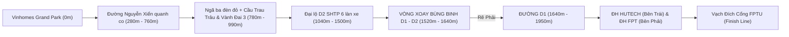

# 🎮 FPTU Student Simulator: Godot 4 Edition
# BẢN KẾ HOẠCH THIẾT KẾ & LỘ TRÌNH PHÁT TRIỂN CHI TIẾT (GAME DESIGN DOCUMENT & MASTER PLAN)

> **Tên dự án:** *FPTU Student Simulator: Đường Đến Trường (Godot 4 3D Edition)*  
> **Thể loại:** 3D Action / Campus Life Simulator / Racing & Interactive Mini-games  
> **Game Engine:** **Godot Engine 4.2+ (Forward+ Vulkan Renderer)** – đã kiểm thử trên 4.7.2  
> **Ngôn ngữ:** GDScript thuần, không plugin bên thứ ba  
> **Nền tảng mục tiêu:** PC Windows (Tối ưu hóa chạy mượt 60 – 120 FPS trên cả card đồ họa tích hợp lẫn card rời NVIDIA RTX)  
> **Thư mục dự án:** `c:\Users\nguye\.gemini\antigravity-ide\scratch\fptu-godot4-simulator\`  
> **Phiên bản gameplay:** v2 (2026-10-20) – xem `docs/superpowers/specs/2026-10-20-gameplay-redesign-design.md`

---

## 🎯 I. TẦM NHÌN DỰ ÁN (PROJECT VISION)

Tái hiện một ngày sinh tồn điển hình nhưng đầy ắp drama, sự hài hước và thử thách của sinh viên **Đại học FPT TP.HCM** — từ khoảnh khắc phóng xe máy bạt mạng qua cung đường Nguyễn Xiển – Khu Công nghệ cao để kịp giờ Roll Call 07:30, đến mê cung bãi xe D1, ải phòng học lạnh 16°C, tuyệt kỹ Vovinam, và trận chiến boss nộp đồ án Capstone lúc 23:59.

Game kết hợp giữa **mô phỏng đường phố thực tế chuẩn Google Maps** và **lối chơi arcade cuốn hút**, mang đậm chất văn hóa bản địa sinh viên FPTU (áo cam, thẻ sinh viên dây cam, xe F-Bus, 7-Eleven campus, tòa nhà núi xanh VTN, sân võ Vovinam, hệ thống FAP/EOS).

**Bốn nguyên tắc gameplay v2:**
1. Mỗi pha trong mỗi màn tối đa 60–90 giây, không lúc nào người chơi ngồi không.
2. Cứ 10–15 giây có một quyết định hoặc một sự kiện bất ngờ.
3. Thua phải có cảm giác "thiếu chút nữa thôi" (hiện % tiến độ / HP boss còn lại khi thua, retry 1 nút).
4. Một ngày liên mạch: đồ mua ở 7-Eleven (Màn 5) dùng được ở Màn 2, Màn 3; kết quả từng màn hiện rank trong Campaign Hub.

---

## 🏗️ II. KIẾN TRÚC KỸ THUẬT & CẤU TRÚC DỰ ÁN

```plaintext
fptu-godot4-simulator/
├── project.godot               # Forward+, 1280x720, autoload StageManager + GameFX, cờ Jolt areas_detect_static_bodies, preset render "nặng" (MSAA+FXAA, shadow 8192, SSAO/SSIL/SSR max, SDFGI)
├── run_game.bat                # 1-click: check-only -> smoke test -> chạy game
├── generate_textures.py        # Pipeline texture 2D vẽ bằng Pillow (bảng hiệu, HUD) – KHÔNG AI gen
├── generate_audio.py           # Tổng hợp WAV bằng code (bô xe, còi, gió, lết bánh...)
├── generate_campus_textures.py # Texture vẽ code cho campus: mái ngói, cỏ, sân gạch, bảng tên, cờ, mái tôn, nhựa đường HD, cỏ billboard + NORMAL MAP (Sobel) (KHÔNG AI gen)
├── crawl_and_bake_fptu.py      # Tải ảnh CHỤP THẬT từ Wikimedia Commons & crop thành texture fptu_*.png
├── reference_photos/           # 10 ảnh chụp thực tế 100% (xem README.md) – nguồn duy nhất cho texture ảnh thật
├── assets/
│   ├── textures/               # 32 texture: bảng hiệu vẽ code + 7 texture crop từ ảnh chụp thật (fptu_*.png, lotus_pond_real.png)
│   └── audio/                  # 9 file WAV tổng hợp
├── docs/superpowers/specs/     # Spec thiết kế gameplay v2
├── docs/preview/               # Ảnh render tự chụp (tests/preview_campus.gd, tests/preview_stage2.gd) để tự kiểm tra đồ hoạ
├── tests/                      # Test headless (xem mục VII)
├── scenes/
│   ├── MainMenu.tscn           # MENU CHÍNH (scene khởi động): nền 3D campus thật + camera bay, Bắt đầu / Chọn màn / Hướng dẫn / Cài đặt / Thoát
│   ├── Main.tscn               # MÀN 1 – đua xe (HUD.tscn, PlayerBike.tscn, RoadTrack.tscn, TrafficCar.tscn)
│   ├── Stage2_Parking.tscn     # MÀN 2 – bãi xe & chạy bộ xuyên campus (dựng lại đúng campus Màn 1 tại gốc toạ độ)
│   ├── Stage3_ClassroomFAP.tscn# MÀN 3 – FAP & sinh tồn 16°C
│   ├── Stage4_Vovinam.tscn     # MÀN 4 – Vovinam
│   ├── Stage5_Canteen.tscn     # MÀN 5 – căn tin & 7-Eleven
│   ├── Stage6_CapstoneBoss.tscn# MÀN 6 – boss Capstone
│   └── StageExtra_EOSExam.tscn # EXTRA – giám thị EOS
└── scripts/
    ├── GameFX.gd               # Autoload: shake, flash, vignette, slow-motion, popup, SFX tổng hợp, helper HUD anchors, preset render + cài đặt đồ hoạ (user://settings.cfg)
    ├── StageManager.gd         # Autoload: chuyển màn, Campaign Hub [M], inventory xuyên màn, rank từng màn, kỷ lục lưu đĩa (user://progress.cfg), về menu chính
    ├── MainMenu.gd             # Menu chính: 5 shot camera qua campus, xe máy chạy D1, hướng dẫn phím, 3 mức đồ hoạ + fullscreen, nhật ký kỷ lục
    ├── PlayerBike.gd           # Xe máy: drift [SPACE], lùi [S], núp gió, near-miss, kẹp làn, mưa trơn
    ├── RoadManager.gd          # Dựng cung đường Google Maps + landmark + gọi RoadEvents
    ├── RoadEvents.gd           # Ổ gà, xe tải hỏng, chó cô Ba, đèn đỏ CSGT, mưa rào, 5 checkpoint hài
    ├── TrafficSpawner.gd       # F-Bus/VinBus cùng chiều, xe máy ngược chiều & xe chậm (có thẻ near-miss)
    ├── HUDManager.gd           # HUD Màn 1: đồng hồ, thưởng/phạt giây, speed lines, overlay mưa, banner
    ├── FPTUCampusBuilder.gd    # Dựng khuôn viên FPTU + HUTECH + đoạn D1 + NỘI THẤT phòng học/lab (dùng chung CẢ 7 MÀN: Màn 1 cuối đường, Màn 2 toàn bộ, Màn 3/6 Lab 402, Màn 4 sân trong, Màn 5 căn tin tầng trệt, Extra phòng 311)
    ├── Stage2_Parking.gd … StageExtra_EOSExam.gd   # Script từng màn
```

**Quy ước HUD:** mọi panel mới dùng `GameFX.anchored_panel()` (MarginContainer + anchors preset) hoặc container chuẩn; không offset tuyệt đối.  
**Quy ước ảnh:** texture ảnh thật `fptu_*.png`, `lotus_pond_real.png`, `fptu_alpha_facade.png` luôn được dùng (mặt tiền tòa VTN & hồ sen hiện ở mọi màn vì campus thật được dựng quanh từng màn; bảng triển lãm ở sân trong; sảnh atrium tại cửa Lab 402). Texture vẽ code mới: `lab_floor_tiles.png` (+ normal map) cho sàn phòng học / căn tin.

---

## 🗺️ III. MÀN 1: ĐUA XE TỪ VINHOMES ĐẾN CỔNG FPTU

### 1. Bản đồ & Địa hình (Google Maps Scale 1:1)
Tuyến đường ~1.930 m bằng `Curve3D` + `CSGPolygon3D` 13.6 m có dải phân cách vàng kép, đi qua 6 phân đoạn:



### 1b. Cụm trường ĐH FPT & HUTECH trên đường D1 (dựng theo ảnh flycam thật + mặt bằng OSM)

* **Phân đoạn 6: Đường D1 & Cụm trường Đại học SHTP (1640m - Đích) – dựng theo ẢNH FLYCAM THẬT + MẶT BẰNG OSM (2026-10-20):**
  * **BÊN TAY PHẢI (`+Z`): ĐẠI HỌC FPT TP.HCM** (`FPTUCampusBuilder.gd`, gốc x=215, ranh giới cách tim đường 13 m)
    * Lô đất ~180 m dọc D1 × 115 m sâu, **đối diện HUTECH qua đường D1**; 2 cổng ở 2 góc mặt tiền (cổng chính x≈221, cổng bãi xe D1 x≈389 = vạch đích).
    * **Toà nhà chính = VÒNG CHỮ NHẬT KHÉP KÍN ~150 × 64 m, rỗng giữa là sân trong**, lùi 21 m so với hàng rào. Hai cánh dài (trước/sau) dày 14 m gồm 6 **module** khối lớp học trắng 5 tầng có **mái ngói đỏ cam một mái dốc**, nối bằng khối link hẹp mái bằng; hai cánh ngắn hai đầu dày 26 m là **khối núi 6–8 tầng giật cấp về phía sân**. Mỗi tầng: viền ban công gạch cam + cây xanh bồn, dải kính lùi sâu, nẹp sàn trắng, hiên cột tầng trệt; **sảnh chính xuyên tầng trệt cạnh dài giáp D1** (x≈296) – hướng đi vào.
    * Sân trong: nửa phía cổng chính lát gạch xám với vệt đỏ cam uốn lượn, nửa phía cổng bãi xe là bãi cỏ + **hồ sen hình thận** (texture ảnh thật) + cây; tượng Cóc Vàng trước sảnh; 7-Eleven/căn tin E2A ở tầng trệt cánh sau.
    * Phía trước toà nhà: dải sân đỏ đưa đón/đỗ xe, **mái che răng cưa** dài, hàng cau + cây rậm ra vỉa hè, vỉa hè **hạ lối xe** tại 2 cổng; **cầu thang ngoài trời trắng 3 đợt × 35 bậc thật (17 cm) + 2 chiếu nghỉ, lan can kính** ôm mặt ngoài cánh trước lên cửa Lab 402 (lầu 4 cánh phải). Phía sau: 2 dãy bãi xe máy có mái với ~200 xe tay ga chi tiết (**MultiMesh**, 15 linh kiện/xe, màu sơn theo instance), lối đi bộ từ lối vào sau ra làn xe, sân bóng mini góc Đông.
    * Mái ngói một mái dốc có **tường trắng + dải kính ở mặt cao**; vật liệu có normal map (mặt tiền, mái, cỏ, sân gạch, vỉa hè, nhựa đường); bãi cỏ phủ 14 000 bụi cỏ billboard (MultiMesh).
    * `build_authentic_campus(parent, origin, rot, opts)` – opts: `colliders` (Màn 2), `parking_gaps`, `skip_barrier_at`, `grass`; tiện ích toạ độ: `lobby_u()`, `back_gap_u()`, `stair_profile()`, `lab402_door()`, `parking_spot_candidates()`; `build_d1_road_piece()`, `build_hutech(…, colliders)`, `build_motorbike()`.
  * **BÊN TAY TRÁI (`-Z`): VIỆN CÔNG NGHỆ CAO ĐẠI HỌC HUTECH** (gốc x=350; mặt tiền kéo dài từ x≈270 đối diện FPT)
    * Cổng hai trụ đá xanh dương viền vàng, biển `hutech_sign.png`; toà chính **khối kính tối màu 8 tầng với hệ lam trắng dọc** (như ảnh flycam), khối Viện CNC 3 tầng, khối nghiên cứu trắng.

### 2. Cơ chế lái & sự kiện (v2)
* **Điều khiển:** `W` ga (tối đa 81 km/h, núp gió 97 km/h), `S` phanh / **lùi xe khi đã dừng**, `A/D` lái, `H` còi.
* **DRIFT `SPACE` + A/D:** bán kính cua giảm ~35%, khói bánh, tiếng rít; giữ ≥0,7s rồi thả → **Drift Boost** +4 m/s trong 1s.
* **Near-miss:** lách sát xe khác (≤2,2 m) ở tốc độ >50 km/h mà không va → **-0,5s** (chuỗi liên tiếp -1s), trần 8s/màn.
* **Sự kiện đường (`RoadEvents.gd`):** 7 ổ gà random Nguyễn Xiển; 2 xe tải hỏng chắn làn trên D2 (vị trí/làn random); chó cô Ba lao qua đường (đâm +3s); **đèn đỏ bất ngờ** trước Cầu Trau Trảu (vượt = CSGT +4s, dừng đúng = +1,5s); mưa rào SHTP 50% (lái trơn, overlay mưa, fog); 5 cổng checkpoint có lời thoại hài.
* **Kẹp làn:** lệch tim đường >6,9 m bị đẩy về lòng đường + giảm tốc; >8,6 m đặt lại ở mép + phạt 1s. Rơi rạch nước: cứu hộ +3s như cũ.
* **Giao thông:** 8 xe buýt (núp gió), 9 xe máy ngược chiều (nguồn near-miss), 4 xe máy chậm cùng chiều.
* **Thời gian:** 100 giây thực = 07:05 → 07:30. Lái sạch + dừng đèn đỏ ≈ 94s; va chạm mỗi lần mất ~2s.

---

## 📋 IV. THIẾT KẾ CÁC MÀN 2 ➔ 6 + EXTRA (GAMEPLAY v2 – ĐÃ TRIỂN KHAI)

### 🅿️ MÀN 2: BÃI XE D1 & CẦU THANG NGOÀI TRỜI LÊN LAB 402 (v3 – DIỄN RA TRONG CAMPUS THẬT CỦA MÀN 1)
* **Bối cảnh liên mạch:** `FPTUCampusBuilder.build_authentic_campus()` dựng đúng campus Màn 1 tại gốc toạ độ (kèm `colliders`), thêm đoạn D1 (`build_d1_road_piece`) và HUTECH đối diện (`build_hutech`). Màn 1 về đích trước cổng bãi xe D1 (u = 174) → Màn 2 bắt đầu trên làn phải D1 ngay 28 m trước cổng đó, FPT bên phải, HUTECH bên trái. Cổng chính bị chắn (biển chỉ xe máy SV sang cổng bãi xe).
* **Pha 1 – Đỗ xe (55s):** rẽ phải vào cổng bãi xe, bị chặn trước barie tới khi quét thẻ `E` (bác bảo vệ cạnh bốt + trụ đầu đọc thẻ); 2 thanh barie mở; chạy ~95 m dọc lối xe ven cánh phải tới bãi xe máy có mái phía sau. **Xe NPC** (đã quét thẻ trước, 4,6 m/s, tới ô sau ~30s) tranh ô gần nhất (143, 104.7); còi `H` làm nó khựng 1,6s; bị cướp → ô dự phòng ở dãy A giữa bãi (106.6, 95.3). **Đỗ hợp lệ** = dừng hẳn + dọc trục Z (<25°) + vào giữa ô, giữ 0,6s; lùi `S`. **Monster** ở máy bán nước sát mặt sau cánh sau (138, 86.6): phải rẽ vào dải 5 m sau toà nhà (mất vài giây).
* **Pha 2 – Chạy bộ (48s): AUTO-RUNNER theo `Path3D`** xuyên campus thật, ~221 m từ ô gần nhất (ngắn hơn ~35 m nếu đỗ ô dự phòng – bù cho người thua cuộc đua ô): ô đỗ → làn xe → lối đi bộ qua dãy A → **lối vào sau** (tầng trệt cánh sau) → sân trong vòng qua **hồ sen** → **sảnh chính** → sân trước → **cầu thang ngoài trời 3 đợt (105 bậc)** → cửa Lab 402. Tuyến lấy từ `stair_profile()` nên người chạy bám đúng bậc thang & chiếu nghỉ. `A/D` 3 làn, `SPACE` nhảy (xe dọn vệ sinh, sàn ướt), `S` trượt (băng rôn CLB), `SHIFT` sprint (6 → 9 m/s). 24 chướng ngại đặt theo tỉ lệ quãng đường; đoạn thang chỉ có người & băng rôn. 3 checkpoint: lối vào sau, sảnh chính, chân cầu thang.
* **Thể lực:** hết = **hụt hơi 2,5s** (chậm 50%, không nhảy, vignette đỏ nhịp tim). `Q` uống Monster (từ kiosk hoặc inventory Màn 5) → đầy ngay + 3s sprint miễn phí.
* Rank theo: đỗ xe nhanh/không bị cướp ô, số lần vấp, số pha né, thời gian dư.

### 💻 MÀN 3: ROLL CALL FAP & SINH TỒN 16°C
* **Bối cảnh (v3 – trong campus thật):** `FPTUCampusBuilder.build_room_interior()` dựng **LAB 402** (cánh phải, module 0, lầu 4, 14 × 11.7 × 3.3 m) ngay trong khối nhà thật: toàn bộ campus xoay 180° quanh gốc để phòng nằm đúng toạ độ (`lab402_room_center()`), cửa sổ +X nhìn xuống sân trong & vòng nhà, cửa sổ +Z nhìn ra sân trước / D1 / HUTECH, cửa ra đúng đỉnh cầu thang ngoài trời. Nội thất: sàn gạch 60 cm (texture vẽ code + normal map), trần đèn tuýp + OmniLight, bảng trắng, 2 máy lạnh, máy chiếu, 7 bàn máy (`build_lab_desk`, màn hình phát sáng, ghế xoay), 10 bạn áo cam ngồi học; nắng xiên từ 2 phía cửa sổ (SDFGI).
* **Pha 1 – FAP (45s):** mã 6 ký tự **ngẫu nhiên** trên màn chiếu. Wi-Fi: mỗi 0,35s có ~55% ký tự bị nhiễu `▒#?*` (phải đoán/chờ), gửi mất 1,8s và 30% timeout. `TAB` bật 4G: 5s không nhập được, sau đó mã rõ và gửi tức thì. **Giảng viên đổi mã mỗi 20s.** Chỉ nhận đúng mã; sai 3 lần = ABSENT (có gợi ý số ký tự đúng vị trí).
* **Pha 2 – Sinh tồn (60s):** thanh **Buồn ngủ** (+6/s) chống bằng `SPACE` đúng nhịp tim 75 BPM (±120 ms: -8, lệch: +3); `C` cà phê -15 (3 ly + cà phê mua ở 7-Eleven); thanh **Đói** (+3/s) >70 thì bụng kêu mỗi 4s → **Giảng viên để ý** +15; `B` bánh bao lén -40 đói (bị thấy khi cô đang nhìn: +30 để ý); **gọi tên 2 lần** (gõ đáp án ngắn trong 8s, pool 10 câu IT/FPTU); **kiểm tra điện thoại 2 lần** (`F` úp trong 1,5s, trễ = tịch thu +40 để ý). Thua: ngủ 100 hoặc để ý 100.

### 🥋 MÀN 4: VOVINAM ĐẠI CHIẾN – ĐÒN CHÂN KẸP CỔ #21
* **Bối cảnh (v3):** thảm võ đặt giữa **nửa sân lát gạch của sân trong** campus thật (gốc sân võ = campus (60.5, 53)); phông là hiên cột cánh trước với băng rôn giải đấu xanh-vàng, 2 cột cờ Vovinam, vòng nhà 4 phía, cóc vàng, hồ sen. Nắng đặt từ phía khán giả để thảm không bị bóng toà nhà che.
* **Rhythm lane 3 vòng:** 85 BPM ×8 nốt → 110 ×10 → 135 ×12. Nốt (⬅ đấm, ➡ chém, ⬆ tấn, ⬇ đá, ␣ hét) chạy vào vùng HIT; Perfect ±70 ms / Good ±150 ms; combo multiplier x1→x4; **3 miss liên tiếp = hít đất mash `SPACE` 10 cái / 4s**. Vòng 3 cần ≥70% trúng (được tập lại 1 lần, không thì rớt môn). Võ sinh capsule có tay/chân pivot: lao đấm, xoay chém, hạ tấn, đá, hét; nộm giật lùi + flash + hit-stop.
* **Finisher chuỗi 5 bước (30s):** giữ `W` 1,2s lấy đà → `SPACE` đúng vòng co → `←→` luân phiên 6 lần/2s → `SPACE` kẹp đúng timing → `↓` quật. Sai bước nào ngã, -3s, làm lại từ bước 1. Thành công: slow-motion 0,28×, camera zoom + orbit, nộm ngã bounce.

### 🏪 MÀN 5: CĂN TIN ĐẠI CHIẾN & 7-ELEVEN
* **Bối cảnh (v3):** căn tin = **tầng trệt MỞ của cánh trước** (opts `open_front_modules: [3, 4]` – không khối mặt tiền, cột tròn, trụ link giữa tách thành 2 cột, sàn terrazzo, đèn trần + OmniLight, vách kính nhìn ra D1 & gầm cầu thang ngoài trời) + **hiên ăn ngoài trời** trải ra sân trong (slab gạch, bồn cây viền, dù cam, ghế đẩu quanh mọi bàn). Quầy cô Ba: mặt inox, kính chắn, 6 khay thức ăn, nồi cơm, bảng menu cam; 7-Eleven: hộp trắng sọc 3 màu, mặt kính, 3 kệ đầy hàng, tủ mát. Camera tự hạ thấp khi vào trong nhà (trần 3.4 m) và nâng cao khi ra hiên. Campus bật `colliders` nên cột/cây/bồn hoa cản đường thật.
* **Pha 1 – Bưng khay Overcooked (60s):** nhân vật `WASD` lấy khay ở quầy cô Ba (`E`), luồn qua 14 NPC đi cắt ngang + 3 nhóm đứng tụ tập (chướng ngại cứng) tới bàn bạn đang vẫy. **Thanh nghiêng khay** trôi theo tốc độ; va NPC giật ±28; đứng yên giữ `SPACE` để cân; tới mép = **đổ cơm**, quay lại quầy. 2 đơn: cơm tấm (bàn phải) và trà đá + mì xào (bàn trái, thêm 5 NPC).
* **Pha 2 – 7-Eleven combo (35s):** đi tới cửa hàng `E`; **kéo thả** (hoặc double-click) 8 món vào giỏ trong ngân sách random **30k / 40k / 50k**; cần ⚡Năng lượng ≥50 & 🧠Tinh thần ≥30. Giá cân để 30k có đúng 1 lời giải (mì 10k + bánh bao 8k + sting 7k + trà 5k), 50k mới đủ Monster 18k. Monster / cà phê lon / bánh bao mua được → `StageManager.inventory` dùng ở Màn 2, 3.

### 💻 MÀN 6: BOSS FIGHT CAPSTONE 23:59 – BULLET-HELL GÕ CHỮ
* **Bối cảnh (v3):** cùng căn **LAB 402** của Màn 3 nhưng **ban đêm** (preset `GameFX.upgrade_scene_visuals(self, "night")`: trời đêm, trăng xanh 0.22, glow mạnh, đèn trần & màn hình là nguồn sáng); campus tối ngoài cửa sổ, 4 bàn máy cá nhân + bàn giữa đặt laptop chung, hộp pizza & lon nước thức đêm; boss Deadline lơ lửng dưới trần, camera đưa vào trong phòng.
* Boss 1.600 HP phóng **đạn lỗi** (`404`, `null`, `NPE`, `CORS`, `merge`, `deadlock`, `segfault`…) rơi xuống 4 làn ứng 4 thành viên; 3 wave nhanh dần (23:57:30 → 23:59). **Gõ đúng từ** → nổ, sát thương = độ dài × 6 × combo (x1→x3). Gõ sai = mất combo. Đạn chạm đáy → thành viên làn đó mất 18–26 HP (hoặc Shield chặn). 2 người gục = thua.
* `TAB` đổi thành viên, `ENTER` dùng skill: Leader *Clean Architecture* (xóa 3 đạn thấp nhất, 10s) · Frontend *CSS Shield* (chặn 3 đạn, 12s) · Tester *Ném SRS* (đóng băng 2,5s, 15s) · **Seen-ko-rep đang NGỦ**: chọn + `ENTER` → **mash `SPACE` 14 lần/4s** gọi dậy → mở skill *git merge* (+40 HP team, 20s).
* **Boss ≤40% HP → 3 Git Merge Conflict:** chọn `←` HEAD / `→` teammate đúng trong 8s (đúng: boss -12%, sai: team -25 HP). Rồi **gõ `git push origin main`** (đạn vẫn rơi) để nộp. Thắng: pháo hoa + Cóc Vàng.

### 🕵️ EXTRA: GIÁM THỊ EOS BẮT TOOL CHEAT
* **Bối cảnh (v3):** **PHÒNG 311** thật (cánh trước, module 4, lầu 3, 12 × 10 × 3.3 m, `room311_center()`), cửa sổ 2 phía (D1 thấy HUTECH / sân trong). 16 máy thi thu nhỏ 0.62× xếp lưới 2.6 × 2.35 m; giám thị đi 4.2 m/s.
* **Camera & điều khiển (v3.1):** camera góc nhìn thứ ba **xoay theo hướng nhân vật** (lười bám sau lưng 2.8 m, lệch vai phải, `cam_yaw` lerp_angle 3.5/s, không đuổi khi nhân vật quay ngược >110° để giữ [S] không bị quay vòng), kẹp trong phòng; sát tường thì hạ thấp + thân giám thị mờ dần (alpha theo khoảng cách). **WASD tính theo hướng camera** ([W] tiến theo hướng nhìn, [A]/[D] rẽ). CCTV = camera phối cảnh gắn góc trần sau-phải (fov 92) nhìn chéo xuống thấy mặt màn hình 16 máy, có hộp camera + đèn đỏ; rê chuột chọn máy như cũ.
* **Lỗi hiển thị đã sửa (2026-10-20):** (1) `GameFX.anchored_panel` nở sai hướng → panel neo mép (Sổ bằng chứng, dòng gợi ý đáy, CCTV, panel nhịp tim Màn 3, pha 2 Màn 2...) bị cắt nửa ngoài màn hình – nay hướng nở theo mép neo; (2) dải kính tối của mặt tiền (khối đặc cao 1.5 m) xuyên qua phòng nội thất → camera trên nóc dải thấy mảng đen (CCTV đen kịt) – builder nhận diện module chứa phòng (`interior_room_aabbs()`) và thay khối bằng 2 quad hướng ra ngoài; (3) camera đi tuần chui vào trần → màn đen.
* 90s, 16 máy, **6 thánh tool random mỗi lượt** (2 Alt+Tab từ 0s · 2 điện thoại từ 25s · 2 tai nghe/Apple Watch từ 50s), cần bắt 5. "Tell" chỉ lộ 1,5s → 0,85s mỗi 5–9s; sinh viên ngay thẳng cũng vươn vai/gãi đầu (nhiễu).
* `C` đổi **CCTV top-down** (rê chuột chọn máy). `S` **chụp bằng chứng** (tối đa 8 ảnh) – chỉ có giá trị khi tell đang diễn ra. `E` soi máy → đối chiếu Quy chế (Đ1 ứng dụng ngoài EOS, Đ2 thiết bị liên lạc, Đ3 thiết bị đeo tay) → **lập biên bản chỉ khi có bằng chứng của đúng máy**. Ép biên bản không bằng chứng (`Shift+SPACE`): đúng người -10 uy tín, **bắt oan -35 uy tín**; uy tín ≤0 = bị đình chỉ coi thi. Rank theo điểm + uy tín + thời gian.

---

## 📅 V. LỘ TRÌNH PHÁT TRIỂN & TIẾN ĐỘ THỰC HIỆN (ROADMAP)

| Giai đoạn | Trọng tâm công việc | Trạng thái |
| :--- | :--- | :---: |
| **Phase 1** | Màn 1: đường Google Maps, bùng binh, FPT/HUTECH, cứu hộ, núp gió, HUD | ✅ Hoàn tất |
| **Phase 2** | Âm thanh: bô xe theo RPM, còi, gió, lết bánh, drift loop, SFX tổng hợp trong `GameFX` | ✅ Hoàn tất |
| **Phase 3** | Màn 2: đỗ xe có đối thủ, đỗ hợp lệ, lùi xe, auto-runner Path3D, stamina có nghĩa, Monster; **v3: toàn bộ màn diễn ra trong campus thật dùng chung builder với Màn 1** | ✅ Hoàn tất (v3) |
| **Phase 4** | Màn 3 (FAP Wi-Fi lag, đổi mã, sinh tồn đa nhiệm) & Màn 4 (rhythm lane, hít đất, finisher 5 bước) | ✅ Hoàn tất (v2) |
| **Phase 5** | Màn 5 (Overcooked + kéo thả), Màn 6 (bullet-hell typing + Git conflict), Extra (bằng chứng, CCTV, uy tín) | ✅ Hoàn tất (v2) |
| **Phase 5b** | Gameplay v2 Màn 1: drift, near-miss, sự kiện đường, đèn đỏ, mưa, kẹp làn, speed lines | ✅ Hoàn tất |
| **Phase 6** | Đóng gói Windows Executable, cài đặt đồ họa Low/Medium/High, menu chính, icon Cóc Vàng, GitHub Release v1.0.0 | ✅ Hoàn tất |
| **Phase 7 (v1.1) – M1** | Quick wins theo `docs/GAME_DESIGN_REVIEW_2026-10-20.md`: near-miss sớm + chuỗi nhân thưởng, cửa hàng 7-Eleven bằng phím, thẻ chuyển cảnh, menu tạm dừng, bus âm thanh + âm lượng, test HUD không bị cắt | ✅ Hoàn tất |
| **Phase 7 – M2a/b** | **Người & đồ vật giống thật** (yêu cầu chủ dự án 20/10/2026): `CharacterBuilder` (người nhiều phần, mặt vẽ Pillow, 13 preset, animation thủ tục) thay mọi capsule ở 7 màn + menu; `PropBuilder` (xe tay ga ~50 chi tiết, xe buýt, nộm gỗ, cây, cột đèn, bàn ghế dù, khay cơm) | ✅ Hoàn tất |
| **Phase 7 – M2c** | Ánh sáng theo giờ từng màn (`GameFX.TOD_PRESETS`), nhạc nền thủ tục thích ứng (`MusicDirector`, 8 style, tension theo tốc độ/chuỗi/máu boss) | ✅ Hoàn tất |
| **Phase 7 – M2d** | Đời sống campus (đám đông bake MultiMesh), review #4 (10 s khởi động Màn 1), #6 (căn tin công bằng) | 📅 Kế hoạch |
| **Phase 7 – M3/M4** | Tổng kết ngày, thành tích, thử thách ngày, tay cầm/đổi phím, CI test job, tối ưu, tách StageBase, changelog, v1.1.0 | 📅 Kế hoạch |

---

## 🕹️ VI. HƯỚNG DẪN ĐIỀU KHIỂN

* **Khởi chạy:** nhấp đúp [run_game.bat](file:///c:/Users/nguye/.gemini/antigravity-ide/scratch/fptu-godot4-simulator/run_game.bat) (check-only → smoke test có quét dòng ERROR → game). Game mở vào **MENU CHÍNH** (`scenes/MainMenu.tscn`): nền là campus thật với camera bay 5 góc + xe máy trên D1; nút **▶ Bắt đầu ngày mới** (reset vật phẩm/kết quả phiên → Màn 1), **📋 Chọn màn** (Campaign Hub, có rank phiên + kỷ lục), **🎮 Hướng dẫn điều khiển**, **⚙ Cài đặt đồ hoạ** (Thấp / Trung bình / Cao + Fullscreen, lưu `user://settings.cfg`, áp dụng qua `GameFX.upgrade_scene_visuals`), **✖ Thoát**; bảng **Nhật ký hành trình** hiện kỷ lục từng màn (`user://progress.cfg`). Điều hướng bằng chuột hoặc ↑↓ + Enter. Trong game bấm **`M`** để mở Campaign Hub (có nút 🏠 Về menu chính).
* **Màn 1:** `W` ga · `S` phanh/lùi · `A/D` lái · `SPACE` + `A/D` drift (thả để boost) · `H` còi · dừng đèn đỏ bằng `S`.
* **Màn 2:** `E` quét thẻ · `H` còi dọa xe tranh ô · `S` lùi · pha leo: `A/D` làn, `SPACE` nhảy, `S` trượt, `SHIFT` sprint, `Q` Monster.
* **Màn 3:** gõ mã + `ENTER` · `TAB` 4G · `SPACE` đúng nhịp · `C` cà phê · `B` bánh bao · `F` úp điện thoại · gõ đáp án khi bị gọi tên.
* **Màn 4:** `←→↑↓ SPACE` theo nốt (hoặc `A D W S`) · hít đất mash `SPACE` · finisher: giữ `W`, `SPACE`, `←→` luân phiên, `SPACE`, `↓`.
* **Màn 5:** `WASD` đi · `E` lấy khay / giao / vào 7-Eleven · đứng yên giữ `SPACE` cân khay · kéo thả hoặc double-click món, bấm món trong giỏ để bỏ.
* **Màn 6:** gõ chữ · `BACKSPACE` xóa · `TAB` đổi người · `ENTER` skill / gọi điện · `SPACE` mash khi gọi · `←/→` chọn khối code conflict.
* **Extra:** `WASD` đi tuần · `C` CCTV · `S` chụp · `E` soi/lập biên bản · `Shift+SPACE` ép biên bản.

---

## 📦 VIII. PHÁT HÀNH (GitHub + bản Windows chơi ngay)

* **Export an toàn:** mọi ảnh/âm thanh nạp lúc chạy đi qua `GameFX.load_image_any()` / `GameFX.load_wav()` (đọc byte thô qua `FileAccess`), vì `ProjectSettings.globalize_path("res://…")` không dùng được trong PCK. `export_presets.cfg` (preset "Windows Desktop", nhúng PCK vào exe, loại `tests/ docs/ reference_photos/ *.py *.bat *.md`); `assets/textures/*.png` và `assets/audio/*.wav` dùng `.import` kiểu `importer="keep"` nên được đóng gói nguyên bản, không nhân đôi. `docs/` và `reference_photos/` có `.gdignore` (không import, chỉ nằm trên GitHub).
* **Build tại máy:** `build_windows.bat` (cần Export Templates 4.7.2 cài trong Godot Editor) → `build/FPTU-Student-Simulator-windows.zip`.
* **Build tự động:** `.github/workflows/release.yml` – push tag `v*` → GitHub Actions tải Godot 4.7.2 + templates, `--import`, check-only, smoke (fail nếu có dòng ERROR), export, zip, đính kèm vào Release. Người chơi tải zip từ tab Releases, giải nén, chạy `FPTU-Student-Simulator.exe`.
* **Repo:** `README.md` cho người chơi/người xem GitHub; `.gitignore` bỏ `.godot/`, `build/`, log.
* **Icon:** `generate_icon.py` tạo `assets/icon/cocvang_icon.png` (1024) + `.ico` (16–256) từ ảnh cóc do user cung cấp – flood-fill tách nền, đổi da xanh lá → vàng (hue 50°, V nâng 0.72+0.3·V), áo xanh dương → cam FPT, vẽ logo FPT 3 khối góc dưới phải; `project.godot` `config/icon` + `config/windows_native_icon`, preset `application/icon` + `modify_resources=true` (Godot ≥ 4.1 tự nhúng, không cần rcedit).

## 🚀 IX. NÂNG CẤP v1.1 – M1 "QUICK WINS" (20/10/2026)

Thực hiện theo `docs/PROMPT_FULL_UPGRADE.md` (brief) và `docs/GAME_DESIGN_REVIEW_2026-10-20.md` (review 12 mục):

* **#1 Near-miss sớm & chuỗi nhân thưởng (Màn 1):** `TrafficSpawner` rải xe ngược chiều thành cụm ở 150/380/520/680/900/1250 m (tránh khúc cua Nguyễn Xiển) thay vì ngẫu nhiên → cú sát nút đầu tiên < 10 s thay vì ~57 s. `PlayerBike` giữ chuỗi trong 6 s (`NEAR_MISS_CHAIN_WINDOW`), lưu `longest_near_miss_chain`, whoosh tăng cao độ theo chuỗi, hit-stop 40 ms từ x3. `HUDManager`: thưởng 0.5/0.75/1.0 s theo bậc, bảng "SÁT NÚT xN" giữa trên với thanh thời gian chuỗi, điểm + `longest_chain*60`, ngưỡng rank 1250/800/450.
* **#2 Cửa hàng 7-Eleven bằng phím (Màn 5):** lưới 4×2, `[←→↑↓]`/WASD chọn, `[ENTER]`/`[E]` thêm, `[BACKSPACE]` bỏ món cuối, `[TAB]` sang giỏ, `[SPACE]` trả tiền (rung bảng + tiếng lỗi nếu chưa đủ). Chuột kéo thả vẫn dùng được. Bot mua hoàn toàn bằng phím.
* **#5 Thẻ chuyển cảnh:** `StageManager._begin_transition` – lớp tối + đồng hồ chạy từ giờ màn trước tới giờ màn sau (đọc từ tiêu đề `[HH:MM AM]`), tên màn, 1 câu thoại theo kết quả (S / thắng / thua / tối Capstone), 3 s hoặc bấm phím bất kỳ; **bỏ qua hoàn toàn khi headless** để bot không bị chậm.
* **Menu tạm dừng (ESC):** CanvasLayer 118, `process_mode ALWAYS`, `get_tree().paused`; Tiếp tục / Cài đặt (3 mức đồ hoạ áp ngay cho cảnh hiện tại + 4 thanh âm lượng) / Điều khiển (bảng phím dùng chung `StageManager.CONTROLS_GUIDE` với menu chính) / Campaign Hub / Về menu / Thoát. Không bật trong MainMenu, ESC đóng hub trước. `change_stage`/`go_to_main_menu` luôn bỏ pause.
* **Âm thanh:** `GameFX._setup_audio_buses()` tạo bus Music/SFX/UI gửi về Master (có limiter) lúc chạy; pool SFX → bus SFX, `play_ui()` → bus UI, `route_audio_to_bus()` cho player của xe máy; âm lượng lưu `settings.cfg [audio]`, thanh trượt trong menu chính & menu tạm dừng (`build_audio_settings`).
* **Kiểm thử:** `tests/test_hud_bounds.gd` nạp menu + 7 màn ở 1280×720 / 1920×1080 / 2560×1440 và khẳng định mọi Control hiển thị nằm trong viewport (đã bắt được SleepPanel Màn 3 tràn phải → `grow_horizontal = BEGIN`). `tests/preview_m1_ui.gd` chụp 5 ảnh UI mới (`docs/preview/m1_*.png`).
* **Baseline FPS (RTX laptop, cửa sổ 1280×720, 1 frame sau khi nạp – chỉ tham khảo, số thấp là frame đầu còn biên dịch shader):** High: menu 156, S3 7, S4 50, S5 41–60, S6 60, Extra 31–87 · Medium: menu 226, S3 66, S4 1*, S5 60–91, S6 60, Extra 31 · Low: menu 172, S3 12*, S4 80–87, S5 4*, S6 48, Extra 44–67 (*: frame đầu). M4 sẽ đo lại bằng trung bình 120 frame.
* **Gotcha mới:** script được `--script` test tham chiếu trực tiếp bằng `class_name` (vd `PlayerBike.attach_near_miss_tag`) bị biên dịch TRƯỚC khi autoload đăng ký → trong script đó không được dùng định danh `GameFX`/`StageManager`, phải `get_node_or_null("/root/GameFX")`.

## 🧍 X. NÂNG CẤP v1.1 – M2: NGƯỜI & ĐỒ VẬT GIỐNG THẬT (20/10/2026)

Yêu cầu chủ dự án: *"người và đồ vật giống thật hơn thay vì chỉ là các khối hình"* – vẫn giữ ràng buộc KHÔNG ảnh AI, GDScript thuần, không plugin: mọi thứ là hình học thủ tục + texture vẽ bằng code.

* **`scripts/CharacterBuilder.gd`** – `build(opts)` trả về Node3D (chân ở y=0, mặt hướng -Z): thân là mesh tiện (lathe) có vai/eo/hông thật (nam/nữ khác profile), đầu ellipsoid dán **bản đồ mặt** (mắt, mày, môi, má hồng; bản nhắm mắt để chớp) do `generate_character_textures.py` vẽ, mũi, tai, 9 kiểu tóc, cổ áo, tay áo, tay 2 đoạn + bàn tay, chân 2 đoạn + giày, thắt lưng, ba lô, kính, dây đeo thẻ, cà vạt, phù hiệu, cầu vai, tạp dề, mũ bếp, mũ kê-pi, mũ bảo hiểm. 13 preset (`student`/`_m`/`_f`, `player`, `rider`, `lecturer`, `guard`, `cop`, `vovinam`, `master`, `cook`, `proctor`, `casual`); biến thể theo seed (4 tông da, 5 màu tóc, chiều cao, vai). Mỗi khớp là pivot (`get_pivot(root, "head"|"shoulder_r"|"thigh_l"…)`), `head_top()` để treo Label3D.
* **Animator** (node con "Animator"): thở, đổi trọng tâm, bước đi/chạy theo `set_speed(m/s)`, nhìn theo `look_at_point()`, chớp mắt, LOD theo khoảng cách camera; clip `play()`: sit, type, eat, phone, sleepy(_sit), cheer, flinch, facepalm, wave, bow, nod, stance, punch, chop, kick, ride, guard, lie, carry, jump, slide, plank, slump; `set_base_clip()` để one-shot quay về tư thế nền (vd võ sinh về "stance"); `pose()` đặt tư thế tĩnh không cần Animator; `bake()` gộp thành 1 ArrayMesh nhiều surface (đám đông MultiMesh, `build_baked_rider()` cho xe NPC); `set_opacity()` (giám thị mờ dần).
* **`scripts/PropBuilder.gd`** – `build_scooter()` xe tay ga (bánh lốp/vành/nan hoa/đĩa phanh, phuộc, yếm 3 tấm, hộc đồ, sàn, thân sau tiện, yên da, baga, đèn hậu, biển số 59-X1, ống xả + pô, chân chống, đèn pha, táp-lô, bao tay, phanh, gương, xi-nhan; `baked` cho NPC), `build_scooter_parts()` lắp vào pivot của `PlayerBike.tscn` (bánh quay, ghi-đông bẻ lái), `build_bus()` F-Bus/VinBus (thân, dải kính + trụ, cửa gập, kính lái, gương, đèn, cản, dải trang trí texture, 4 bánh), `build_training_dummy()`, `build_tree()` (thân cong, rễ bạnh, cành, 8–10 khối lá, bake), `build_lamp_post()`, `build_tray()` (dĩa cơm/bún, chén canh, ly trà đá, đũa), `build_table()/build_stool()/build_umbrella()`. Texture: `generate_prop_textures.py` (gỗ, kim loại xước, da, gai lốp, biển số, dải xe buýt).
* **Đã thay ở:** Màn 1 (người lái + xe tay ga, 19 xe NPC + người lái bake, 8 xe buýt, hàng cây + cột đèn D2, anh CSGT), menu (xe trên D1), Màn 2 (bảo vệ, đối thủ + xe, runner với clip nhảy/trượt/vấp, NPC sinh viên/giảng viên), Màn 3 (cô giáo đi lại, 10 bạn học gõ máy/ngủ gật/điện thoại), Màn 4 (võ sinh – đòn là clip, thầy, 8 đồng môn, nộm gỗ), Màn 5 (cô Ba sau quầy 1 m, 3 nhóm tán gẫu, người chơi bưng khay, bạn vẫy, 19 người đi lại có khay, bàn gỗ/ghế đẩu/dù), Màn 6 (4 thành viên gõ máy/gục/nằm ngủ), Extra (giám thị, 16 thí sinh ngồi; tell điện thoại/tai nghe/đồng hồ gắn vào pivot đầu/khuỷu tay).
* **Ánh sáng theo giờ (M2c):** `GameFX.upgrade_scene_visuals(root, preset)` nhận preset giờ trong ngày (`TOD_PRESETS`): `dawn` 07:05 (Màn 1, menu – nắng thấp 18°, vàng cam, sương ấm, bóng dài), `morning` 07:12 (Màn 2), `morning_indoor` 07:30 (Màn 3 – nắng lạnh + sương thể tích mỏng trong phòng ở mức Cao), `noon` 09:30 (Màn 4 – nắng gắt 58°, tương phản cao), `midday_open` 11:30 (Màn 5 – nắng đỉnh 70° + sương nhiệt), `exam` 08:00 (Extra – trung tính), `night` 23:00 (Màn 6). Tên cũ `outdoor`/`indoor` là alias; preset được lưu meta `visual_preset` trên cảnh để menu tạm dừng áp lại khi đổi mức đồ hoạ.
* **Nhạc nền thủ tục (M2c):** `scripts/MusicDirector.gd` – bộ tổng hợp real-time qua `AudioStreamGenerator` 22,05 kHz (kick quét tần số, snare/hi-hat nhiễu, bass răng cưa lọc 1 cực, pad 3 sin glide, lead), sequencer 16 bước, 8 style (menu, ride, parking, classroom lo-fi có tiếng đĩa than, vovinam, canteen bossa, capstone tối dồn dần, exam thưa + nhịp tim); `GameFX.music_play(style, tension)` gọi ở `_ready` mỗi màn, `GameFX.music_tension()` theo tốc độ + chuỗi near-miss (Màn 1) và máu boss (Màn 6); bus "Music"; vẫn chạy khi tạm dừng (GameFX `PROCESS_MODE_ALWAYS`). Test `tests/test_music.gd`.
* **Gotcha:** `SphereMesh.is_hemisphere` dùng `height` làm chiều cao *của bán cầu* (đặt `height = r`); `SurfaceTool` mặt trước theo chiều kim đồng hồ; `--script` biên dịch script được tham chiếu bằng `class_name` TRƯỚC khi autoload đăng ký → `CharacterBuilder`/`PropBuilder`/`FPTUCampusBuilder` không dùng định danh `GameFX` (nạp ảnh bằng `FileAccess`); script mới cần `godot --headless --import` để vào cache `class_name`; Pillow chỉ blend alpha khi vẽ lên ảnh **RGB** với `ImageDraw.Draw(im, "RGBA")`.

## 🧪 VII. KIỂM THỬ HEADLESS (tests/)

| Lệnh | Kiểm tra |
| :--- | :--- |
| `godot --headless --quit --check-only --path .` | Biên dịch toàn bộ script |
| `godot --headless --path . --script tests/smoke_all_stages.gd` | Parse mọi script, nạp & chạy 75 frame menu + cả 7 scene màn chơi |
| `tests/test_main_menu.gd` | Menu: 5 nút, hướng dẫn mở/đóng, đổi mức đồ hoạ + lưu settings, mở hub, Bắt đầu ngày mới reset inventory & nạp Màn 1 |
| `tests/test_stage1_race.gd` | Autopilot né xe, dừng đèn đỏ, về đích; 5/5 checkpoint |
| `tests/test_near_miss.gd` | Vùng near-miss bắt được xe đứng yên & xe ngược chiều, 0 va chạm |
| `tests/test_stage2_stairs.gd` | Bot auto-runner né/nhảy/trượt, về Lab 402 đúng giờ |
| `tests/test_stage3_classroom.gd` | Nhập sai → strike, 4G, nhịp tim, quiz, úp điện thoại, thắng |
| `tests/test_stage4_vovinam.gd` | 3 vòng rhythm, hít đất, finisher ngã 1 lần rồi thành công |
| `tests/test_stage5_canteen.gd` | Đi bằng phím, lấy/giao khay, cân khay, giải combo đúng ngân sách |
| `tests/test_stage6_capstone.gd` | Gõ chữ, gõ sai, gọi dậy, skill, 3 conflict (1 sai), push cuối |
| `tests/test_stage_extra_eos.gd` | CCTV, chụp bằng chứng, lập biên bản, bắt oan -35 uy tín |
| `tests/test_hud_bounds.gd` | Menu + 7 màn ở 3 độ phân giải: không Control nào tràn khỏi viewport |
| `tests/test_character_builder.gd` | 13 preset đủ pivot/≥20 mesh, 21 clip chạy 120 frame, bake() ≥3 surface, set_opacity, 16 texture mặt |
| `tests/test_music.gd` | MusicDirector phát đủ 8 style, đổi tension, fade-out, quãng 8 đúng x2 |
| `godot --path . --script tests/preview_campus.gd` (cần cửa sổ) | Chụp 7 góc campus trong Màn 1 → `user://preview/*.png` (bản sao ở `docs/preview/`) |
| `godot --path . --script tests/preview_stage2.gd` (cần cửa sổ) | Chụp 9 góc Màn 2: D1, cổng bãi xe, lối xe, bãi xe, lối sau, sân trong, cầu thang, cửa Lab 402, toàn cảnh |
| `godot --path . --script tests/preview_stages.gd` (cần cửa sổ) | Chụp Màn 3, 4, 5, 6, Extra từ camera gameplay + 1–2 góc phụ (cửa sổ, hiên, CCTV) |
| `godot --path . --script tests/preview_m1_ui.gd` (cần cửa sổ) | Chụp bảng chuỗi near-miss, menu tạm dừng + cài đặt, thẻ chuyển cảnh, cửa hàng bằng phím |
| `godot --path . --script tests/preview_characters.gd` (cần cửa sổ) | Studio nhân vật: 12 preset, cận mặt, 12 clip, nhìn sau, đám đông bake 60 người |
| `godot --path . --script tests/preview_props.gd` (cần cửa sổ) | Studio đồ vật: xe tay ga, xe buýt, nộm, cây + đèn, bàn ghế dù, khay |
| `PEOPLE_ONLY=s1,s5 godot --path . --script tests/preview_people.gd` (cần cửa sổ) | Người & đồ vật trong từng màn từ camera gameplay + góc cận |

**Đồ hoạ ("nặng cũng được"):** `project.godot` bật MSAA 2x + FXAA + debanding, lọc dị hướng, shadow map 8192 bóng mềm chất lượng cao, SSAO/SSIL/SSR chất lượng cao, SDFGI hội tụ nhanh, sương thể tích độ phân giải cao. Mỗi màn gọi `GameFX.upgrade_scene_visuals(self, "outdoor"/"indoor")` ở cuối `_ready`: nhân bản Environment rồi bật SDFGI (6/4 cascade), SSIL, SSR, glow softlight, tonemap ACES, chỉnh màu nhẹ, sương + sương thể tích (outdoor), bán cầu dưới sky trung tính; nắng dùng PSSM 4 split, bóng mềm. Headless không kiểm được visual → tự render bằng 2 script preview ở trên và xem ảnh.

> Lưu ý kỹ thuật: Godot 4.4+ dùng Jolt, Area3D không phát hiện StaticBody3D → xe NPC gắn thêm Area3D `near_miss_tag` (`PlayerBike.attach_near_miss_tag`) để vùng near-miss phát hiện area-area trên mọi engine.
