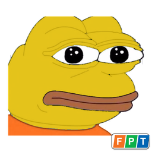
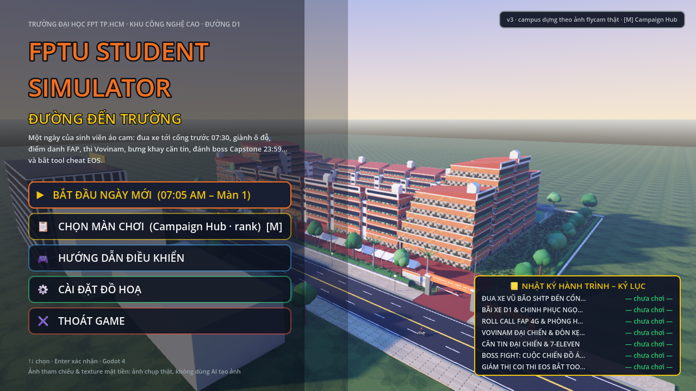
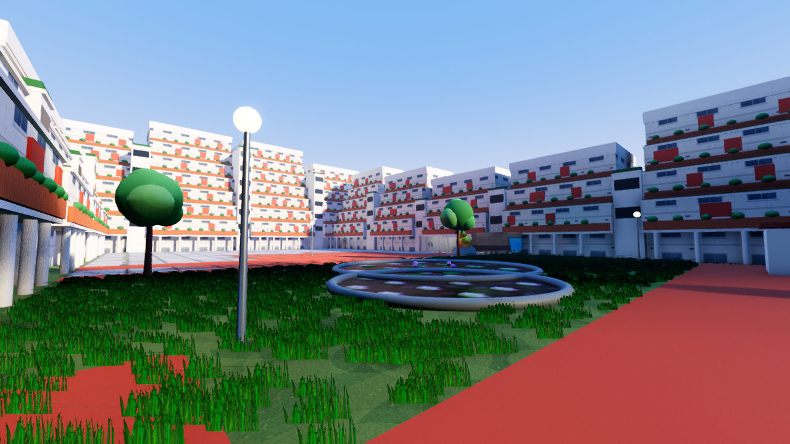
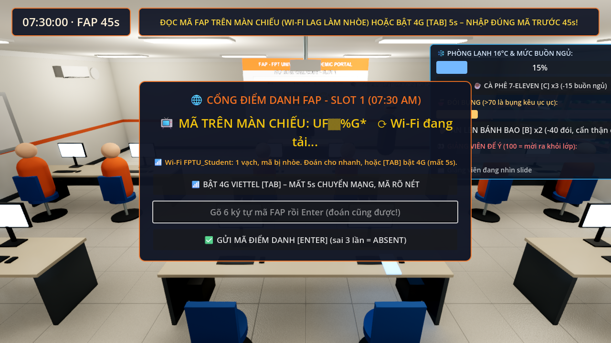
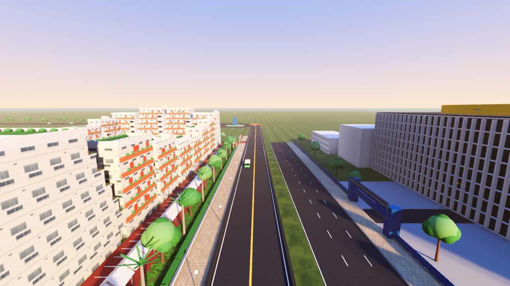
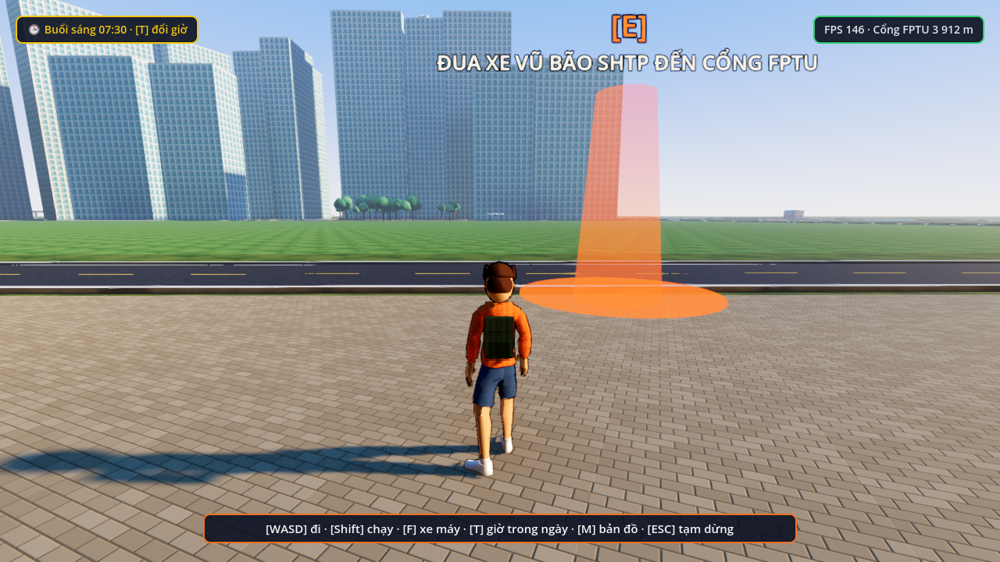
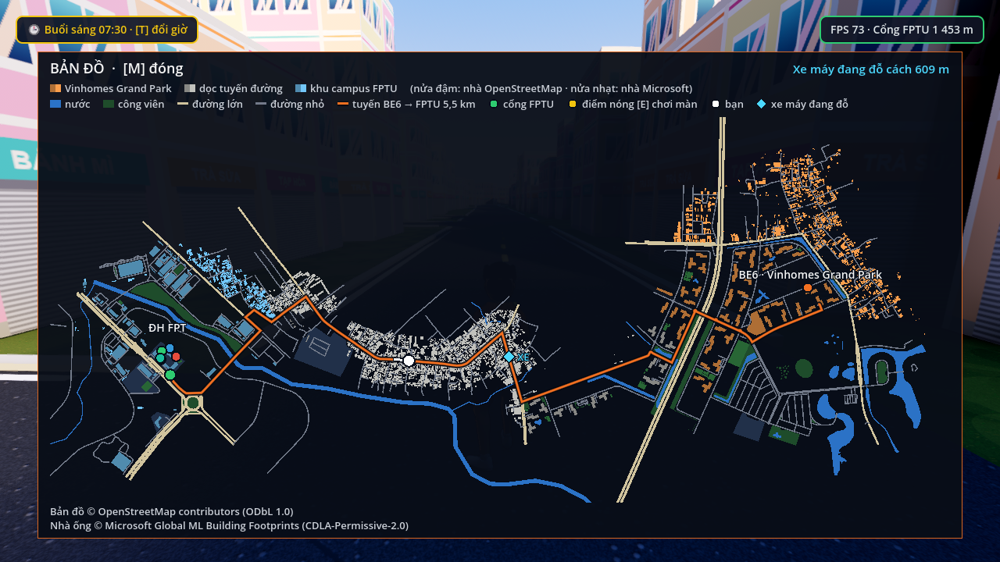

#  FPTU Student Simulator: Đường Đến Trường

Game 3D hài hước mô phỏng **một ngày của sinh viên Đại học FPT TP.HCM** (Khu Công nghệ cao, đường D1), làm bằng **Godot 4.7** thuần GDScript. Khuôn viên trường được dựng lại theo **ảnh flycam thật và mặt bằng OpenStreetMap**: vòng nhà chữ nhật khép kín với sân trong, hồ sen, bãi xe máy, cầu thang ngoài trời, đối diện HUTECH qua đường D1. Toàn bộ 7 màn chơi diễn ra trong chính khuôn viên đó, và chế độ **Thế giới mở** cho bạn đi bộ hoặc chạy xe máy từ toà BE6 ở Vinhomes Grand Park tới trường trên bản đồ thật.



| Màn 2 – sân trong & hồ sen | Màn 3 – Lab 402 | Màn 1 – về đích trên D1 |
| :---: | :---: | :---: |
|  |  |  |

## 🎮 Tải về và chơi ngay (không cần cài Godot)

1. Vào trang **[Releases](../../releases)** và tải file `FPTU-Student-Simulator-windows-*.zip` mới nhất.
2. Giải nén ra một thư mục bất kỳ.
3. Chạy `FPTU-Student-Simulator.exe`. Lần đầu mở có thể chờ vài giây để biên dịch shader.

Yêu cầu: Windows 10/11 64-bit, card đồ hoạ hỗ trợ Vulkan 1.0 (hoặc Direct3D 12). Máy yếu vào **Cài đặt đồ hoạ** trong menu chính để chọn mức Thấp / Trung bình.

> Windows SmartScreen có thể cảnh báo vì file chưa ký số. Chọn *More info → Run anyway*.

## 🗺️ Hành trình một ngày (7 màn)

| Giờ | Màn | Nội dung |
| :--- | :--- | :--- |
| 07:05 | **1 · Đua xe** | Phóng xe máy từ sảnh toà BE6 (Vinhomes Grand Park) theo **đúng tuyến đường thật 5,5 km**: Cầu Vồng 5, Nguyễn Xiển, cầu Rạch Hầm, Nguyễn Văn Tăng, D2B, vòng xoay rồi đường D1 tới cổng FPTU trước 07:30 (5 phút chơi). Drift, núp gió xe buýt, lách sát xe ngược chiều, né ổ gà, dừng đèn đỏ. |
| 07:26 | **2 · Bãi xe & chạy bộ** | Quét thẻ ở cổng bãi xe D1, tranh ô đỗ với xe khác, đỗ cho thẳng, rồi chạy bộ xuyên campus và leo 105 bậc cầu thang ngoài trời lên Lab 402. |
| 07:30 | **3 · Roll call FAP** | Đoán mã điểm danh qua Wi-Fi lag hoặc chờ 4G, rồi sinh tồn trong phòng lạnh 16°C: giữ tỉnh táo, chống đói, trả lời khi bị gọi tên, giấu điện thoại. |
| 09:30 | **4 · Vovinam** | Rhythm game 3 vòng nhanh dần giữa sân trong, hít đất nếu sai nhịp, kết thúc bằng chuỗi Đòn chân kẹp cổ số 21. |
| 11:30 | **5 · Căn tin** | Bưng khay cơm luồn qua biển người áo cam ở căn tin tầng trệt, rồi kéo thả combo 7-Eleven trong ngân sách. |
| 23:00 | **6 · Boss Capstone** | Bullet-hell gõ chữ trong Lab 402 lúc nửa đêm: bắn hạ 404 / NullPointer, gọi dậy đứa seen không rep, resolve Git conflict trước 23:59. |
| 08:00 | **Extra · Giám thị EOS** | Đi tuần phòng thi 311 hoặc xem CCTV, chụp bằng chứng đúng lúc, lập biên bản 5 thánh tool mà không bắt oan. |

Vật phẩm mua ở 7-Eleven (Màn 5) dùng được ở Màn 2 và 3. Kết quả từng màn có rank S/A/B/C, kỷ lục được lưu và hiện trong menu.

## 🌏 Thế giới mở

Chọn **🌏 KHÁM PHÁ CAMPUS** trong menu chính. Bạn xuất phát ngay trước sảnh **toà BE6 (The Beverly, Vinhomes Grand Park)**, bấm `F` lấy xe máy rồi tự chạy **tuyến đường thật 5,5 km** tới campus FPTU (Cầu Vồng 5, Nguyễn Xiển, cầu Rạch Hầm, Nguyễn Văn Tăng, D2B, đường D1), hoặc đi bộ ngắm khu đô thị, kênh đào Hoa giấy, dãy nhà ống hai bên đường. Góc trên phải luôn báo còn bao nhiêu mét tới cổng FPTU.

| Xuất phát ở BE6 | Bản đồ `M` |
| :---: | :---: |
|  |  |

**Điều khiển:** `WASD` chạy bộ · `Shift` chạy nước rút (có thể lực) · `Ctrl` đi bộ · `Space` nhảy (trên xe vẫn là drift) · `Z`/`C` xoay camera · chuột nhìn (bấm chuột để bắt, `ESC` thả) · `F` lên/xuống xe máy (khi lái: `W/S` ga/phanh, `A/D` lái, `SPACE` drift, `H` còi) · `E` vào điểm nóng để chơi màn · `T` đổi giờ (bình minh, sáng, trưa, đêm) · `M` bản đồ · `ESC` tạm dừng.

**6 điểm nóng** (cột sáng màu, đứng vào vòng sáng rồi bấm `E`):

| Điểm nóng | Màn chơi |
| :--- | :--- |
| Sân trước sảnh BE6 | Màn 1 · Đua xe trên tuyến thật tới cổng FPTU |
| Cổng sau campus, cạnh bãi xe | Màn 2 · Bãi xe & chạy bộ |
| Cửa kính sảnh thông tầng nhìn ra sân trong | Màn 3 · Roll call FAP ban ngày, **Màn 6 · Boss Capstone** ban đêm (bấm `T` tới Đêm khuya) |
| Đầu sân bóng, ngoài hàng rào | Màn 4 · Vovinam |
| Căn tin tầng trệt | Màn 5 · Căn tin |
| Sân trong, trước phòng 311 | Extra · Giám thị EOS |

Chơi xong một màn mở từ điểm nóng, bảng kết quả có nút **🏫 VỀ CAMPUS** để quay lại thế giới mở ngay cạnh điểm nóng đó (Màn 1 đưa bạn về BE6). Bấm *Chơi lại* thì nút này vẫn hiện ở lượt sau. Xe máy đang đỗ hiện trên bản đồ, đi xa thì dòng gợi ý báo xe cách bao nhiêu mét; lỡ rơi xuống kênh thì sau 1 giây bạn được đưa lên chỗ khô gần nhất.

Ở phong cách Vice City, mọi nhân vật là người kiểu PS2: tỉ lệ người thật, đầu ít mặt với gương mặt vẽ tay bằng code (8 biểu cảm), quần áo giữ nguyên. Ở cả hai phong cách, thế giới mở đông người hơn: sinh viên kín sân trường, cư dân dạo phố Vinhomes (có người chạy bộ, người tản bộ), người đi bộ trên lề các tuyến đường, nhìn xa vẫn thấy dòng người; xe máy, ô tô và xe buýt chạy đúng làn bên phải và dừng lại khi có người chắn đường. Ban đêm vắng hơn. Va nhẹ thì người đi đường lảo đảo càu nhàu, chạy nước rút hay đi xe tông thì họ ngã rồi đứng dậy bỏ chạy. Rơi từ cao không mất máu: dưới 2,5 m nhún gối, 2,5-6 m lăn, cao hơn thì nằm một lúc rồi đứng dậy.

Bản đồ thế giới mở dựng từ dữ liệu **OpenStreetMap** (© OpenStreetMap contributors, [ODbL](https://www.openstreetmap.org/copyright)) và footprint nhà ống **Microsoft Global ML Building Footprints** (© Microsoft, [CDLA-Permissive-2.0](https://cdla.dev/permissive-2-0/)); trên bản đồ `M`, nhà lấy từ OpenStreetMap tô đậm hơn nhà lấy từ dữ liệu Microsoft.

## 🕹️ Điều khiển

* **Chung:** `M` mở Campaign Hub chọn màn · `ESC` đóng cửa sổ · chuột hoặc `↑↓ Enter` trong menu.
* **Màn 1:** `W` ga · `S` phanh/lùi · `A/D` lái · `SPACE`+`A/D` drift (thả để boost) · `H` còi.
* **Màn 2:** `E` quét thẻ · `H` còi · `S` lùi · pha chạy: `A/D` làn, `SPACE` nhảy, `S` trượt, `SHIFT` sprint, `Q` Monster.
* **Màn 3:** gõ mã + `ENTER` · `TAB` 4G · `SPACE` đúng nhịp · `C` cà phê · `B` bánh bao · `F` úp điện thoại.
* **Màn 4:** `←→↑↓ SPACE` theo nốt · hít đất mash `SPACE` · finisher theo hướng dẫn trên màn hình.
* **Màn 5:** `WASD` đi · `E` tương tác · đứng yên giữ `SPACE` cân khay · kéo thả món vào giỏ.
* **Màn 6:** gõ chữ trên đạn · `TAB` đổi người · `ENTER` skill / gọi điện · `←/→` chọn khối code.
* **Extra:** `WASD` đi tuần (theo hướng camera) · `C` CCTV · `S` chụp · `E` soi / lập biên bản.
* **Thế giới mở:** `WASD` chạy bộ · `Shift` chạy nước rút (có thể lực) · `Ctrl` đi bộ · `Space` nhảy (trên xe vẫn là drift) · `Z/C` xoay camera · chuột nhìn · `F` lên/xuống xe máy · `E` vào điểm nóng chơi màn · `T` đổi giờ · `M` bản đồ · `ESC` tạm dừng.

## 🛠️ Chạy từ mã nguồn / tự build

Cần [Godot 4.7.2](https://godotengine.org/download) (bản chuẩn, không cần .NET).

```bash
# Chạy game kèm kiểm tra cú pháp + smoke test
run_game.bat

# Build bản Windows đóng gói (cần cài Export Templates 4.7.2 trong Godot Editor)
build_windows.bat
```

Phát hành tự động: push một tag `v*` lên GitHub, workflow `.github/workflows/release.yml` sẽ build bản Windows trên máy chủ GitHub và đính kèm file zip vào Release.

Icon game (Cóc Vàng áo cam) được tạo bằng `generate_icon.py` từ ảnh gốc `assets/icon/source_frog.png`: tách nền, đổi tông màu da và áo, vẽ logo – thuần xử lý ảnh bằng Pillow. Exporter của Godot tự nhúng icon này vào file exe.

Kiểm thử headless (không cần cửa sổ): `tests/smoke_all_stages.gd`, `tests/test_stage*.gd`, `tests/test_main_menu.gd`, `tests/test_free_roam.gd` (thế giới mở), `tests/test_mapdata.gd` / `tests/test_mapbuilder.gd` (bản đồ thật). Chi tiết thiết kế xem [PLAN.md](PLAN.md).

## 🧱 Công nghệ & tư liệu

* Godot 4.7 Forward+, GDScript 100%, không plugin. Đồ hoạ: SDFGI, SSIL, SSR, sương thể tích, bóng mềm; 3 mức chất lượng.
* Khuôn viên dựng bằng code theo footprint thật trên OpenStreetMap và ảnh flycam (`scripts/FPTUCampusBuilder.gd` v8: kích thước khu đất, hướng toà nhà, cổng D1, bãi xe phía sau đúng thực tế), dùng chung cho menu và cả 7 màn.
* Bản đồ thế giới mở (Vinhomes Grand Park quanh toà BE6, tuyến đường thật 5,5 km tới trường, khu Công nghệ cao quanh campus) dựng từ dữ liệu **OpenStreetMap**: © OpenStreetMap contributors, giấy phép [ODbL 1.0](https://www.openstreetmap.org/copyright), cùng footprint nhà của **Microsoft** (© Microsoft, giấy phép [CDLA-Permissive-2.0](https://cdla.dev/permissive-2-0/), chi tiết ở dòng dưới). Dữ liệu gốc lưu ở `reference_data/osm/` (không đóng gói vào game); file đã chuyển đổi `assets/data/mapdata.json` được tạo bằng `tools/osm_to_mapdata.py`. Tên cửa hàng, thương hiệu trên bản đồ đã được đổi tên vui; tên đường, khu vực, trường học giữ nguyên.
* Dãy nhà ống dọc các con đường (khoảng 2 500 căn mà OpenStreetMap chưa vẽ) lấy footprint từ **Microsoft Global ML Building Footprints** © Microsoft, giấy phép [CDLA-Permissive-2.0](https://cdla.dev/permissive-2-0/) (bản trích phạm vi game ở `reference_data/msbuildings/`, gộp vào `mapdata.json` với `"source": "msft"`); `scripts/MapBuilder.gd` dựng chúng thành khối gộp theo ô 128 m, có bồn nước inox trên mái.
* Texture mặt tiền, hồ sen và các bảng ảnh là **ảnh chụp thật** cấp phép Creative Commons từ Wikimedia Commons (nguồn ghi trong [reference_photos/README.md](reference_photos/README.md)). Texture còn lại vẽ bằng code (Pillow). **Không dùng AI tạo ảnh.**
* Âm thanh tổng hợp bằng code.

Tên trường, địa danh và thương hiệu xuất hiện trong game chỉ mang tính mô phỏng vui, không liên kết chính thức với các tổ chức đó.
