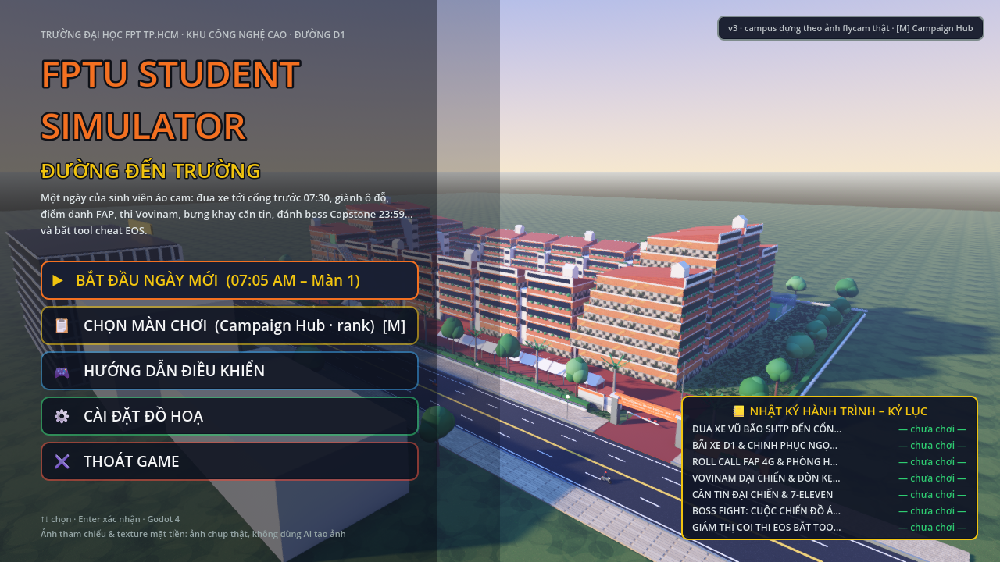
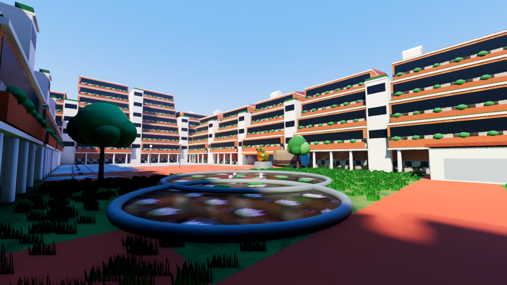
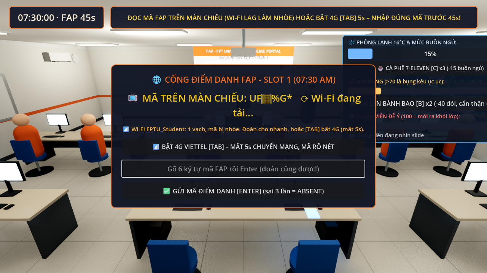
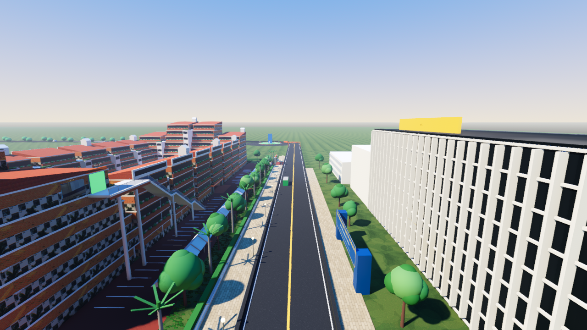

# FPTU Student Simulator: Đường Đến Trường

Game 3D hài hước mô phỏng **một ngày của sinh viên Đại học FPT TP.HCM** (Khu Công nghệ cao, đường D1), làm bằng **Godot 4.7** thuần GDScript. Khuôn viên trường được dựng lại theo **ảnh flycam thật và mặt bằng OpenStreetMap**: vòng nhà chữ nhật khép kín với sân trong, hồ sen, bãi xe máy, cầu thang ngoài trời, đối diện HUTECH qua đường D1. Toàn bộ 7 màn chơi diễn ra trong chính khuôn viên đó.



| Màn 2 – sân trong & hồ sen | Màn 3 – Lab 402 | Màn 1 – về đích trên D1 |
| :---: | :---: | :---: |
|  |  |  |

## 🎮 Tải về và chơi ngay (không cần cài Godot)

1. Vào trang **[Releases](../../releases)** và tải file `FPTU-Student-Simulator-windows-*.zip` mới nhất.
2. Giải nén ra một thư mục bất kỳ.
3. Chạy `FPTU-Student-Simulator.exe`. Lần đầu mở có thể chờ vài giây để biên dịch shader.

Yêu cầu: Windows 10/11 64-bit, card đồ hoạ hỗ trợ Vulkan 1.0 (hoặc Direct3D 12). Máy yếu vào **Cài đặt đồ hoạ** trong menu chính để chọn mức Thấp / Trung bình.

> Windows SmartScreen có thể cảnh báo vì file chưa ký số. Chọn *More info → Run anyway*.

## 🗺️ Hành trình một ngày (7 màn)

| Giờ | Màn | Nội dung |
| :--- | :--- | :--- |
| 07:05 | **1 · Đua xe** | Phóng xe máy từ Vinhomes Grand Park qua Nguyễn Xiển, cầu Trau Trảu, đại lộ D2 tới cổng FPTU trước 07:30. Drift, núp gió xe buýt, lách sát xe ngược chiều, né ổ gà, dừng đèn đỏ. |
| 07:26 | **2 · Bãi xe & chạy bộ** | Quét thẻ ở cổng bãi xe D1, tranh ô đỗ với xe khác, đỗ cho thẳng, rồi chạy bộ xuyên campus và leo 105 bậc cầu thang ngoài trời lên Lab 402. |
| 07:30 | **3 · Roll call FAP** | Đoán mã điểm danh qua Wi-Fi lag hoặc chờ 4G, rồi sinh tồn trong phòng lạnh 16°C: giữ tỉnh táo, chống đói, trả lời khi bị gọi tên, giấu điện thoại. |
| 09:30 | **4 · Vovinam** | Rhythm game 3 vòng nhanh dần giữa sân trong, hít đất nếu sai nhịp, kết thúc bằng chuỗi Đòn chân kẹp cổ số 21. |
| 11:30 | **5 · Căn tin** | Bưng khay cơm luồn qua biển người áo cam ở căn tin tầng trệt, rồi kéo thả combo 7-Eleven trong ngân sách. |
| 23:00 | **6 · Boss Capstone** | Bullet-hell gõ chữ trong Lab 402 lúc nửa đêm: bắn hạ 404 / NullPointer, gọi dậy đứa seen không rep, resolve Git conflict trước 23:59. |
| 08:00 | **Extra · Giám thị EOS** | Đi tuần phòng thi 311 hoặc xem CCTV, chụp bằng chứng đúng lúc, lập biên bản 5 thánh tool mà không bắt oan. |

Vật phẩm mua ở 7-Eleven (Màn 5) dùng được ở Màn 2 và 3. Kết quả từng màn có rank S/A/B/C, kỷ lục được lưu và hiện trong menu.

## 🕹️ Điều khiển

* **Chung:** `M` mở Campaign Hub chọn màn · `ESC` đóng cửa sổ · chuột hoặc `↑↓ Enter` trong menu.
* **Màn 1:** `W` ga · `S` phanh/lùi · `A/D` lái · `SPACE`+`A/D` drift (thả để boost) · `H` còi.
* **Màn 2:** `E` quét thẻ · `H` còi · `S` lùi · pha chạy: `A/D` làn, `SPACE` nhảy, `S` trượt, `SHIFT` sprint, `Q` Monster.
* **Màn 3:** gõ mã + `ENTER` · `TAB` 4G · `SPACE` đúng nhịp · `C` cà phê · `B` bánh bao · `F` úp điện thoại.
* **Màn 4:** `←→↑↓ SPACE` theo nốt · hít đất mash `SPACE` · finisher theo hướng dẫn trên màn hình.
* **Màn 5:** `WASD` đi · `E` tương tác · đứng yên giữ `SPACE` cân khay · kéo thả món vào giỏ.
* **Màn 6:** gõ chữ trên đạn · `TAB` đổi người · `ENTER` skill / gọi điện · `←/→` chọn khối code.
* **Extra:** `WASD` đi tuần (theo hướng camera) · `C` CCTV · `S` chụp · `E` soi / lập biên bản.

## 🛠️ Chạy từ mã nguồn / tự build

Cần [Godot 4.7.2](https://godotengine.org/download) (bản chuẩn, không cần .NET).

```bash
# Chạy game kèm kiểm tra cú pháp + smoke test
run_game.bat

# Build bản Windows đóng gói (cần cài Export Templates 4.7.2 trong Godot Editor)
build_windows.bat
```

Phát hành tự động: push một tag `v*` lên GitHub, workflow `.github/workflows/release.yml` sẽ build bản Windows trên máy chủ GitHub và đính kèm file zip vào Release.

Kiểm thử headless (không cần cửa sổ): `tests/smoke_all_stages.gd`, `tests/test_stage*.gd`, `tests/test_main_menu.gd`. Chi tiết thiết kế xem [PLAN.md](PLAN.md).

## 🧱 Công nghệ & tư liệu

* Godot 4.7 Forward+, GDScript 100%, không plugin. Đồ hoạ: SDFGI, SSIL, SSR, sương thể tích, bóng mềm; 3 mức chất lượng.
* Khuôn viên dựng bằng code từ ảnh flycam thật và OSM (`scripts/FPTUCampusBuilder.gd`), dùng chung cho menu và cả 7 màn.
* Texture mặt tiền, hồ sen và các bảng ảnh là **ảnh chụp thật** cấp phép Creative Commons từ Wikimedia Commons (nguồn ghi trong [reference_photos/README.md](reference_photos/README.md)). Texture còn lại vẽ bằng code (Pillow). **Không dùng AI tạo ảnh.**
* Âm thanh tổng hợp bằng code.

Tên trường, địa danh và thương hiệu xuất hiện trong game chỉ mang tính mô phỏng vui, không liên kết chính thức với các tổ chức đó.
